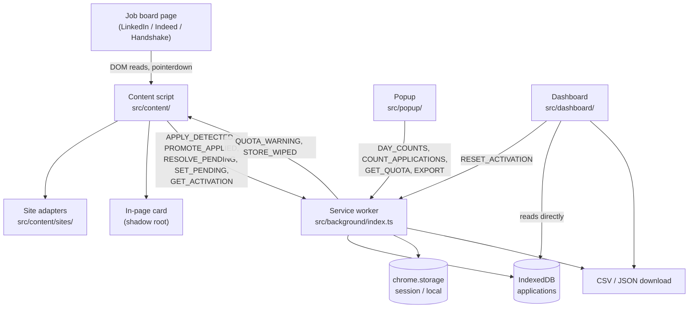

# Engineering notes

## 1. Summary

Jobsearch Copilot is a Chrome MV3 extension that records the jobs I apply to on LinkedIn, Indeed and
Handshake. When I click Apply, it reads the job pane I already have open, stores the posting in
IndexedDB, and later marks it as actually submitted. Nothing leaves the machine: there is no server,
no account and no network request of the extension's own.

The hard part is not the storage or the UI. It is that I do not control any of the three pages I
read. All three are single-page apps whose class names are build-generated and change without
notice; two of them flip the URL before they swap the detail pane, so the obvious moment to capture
a job is the moment the pane still holds the previous one; one of them opens its apply flow in a
different tab, so there is no confirmation to observe in the tab I am watching. Most of the design
here is about those facts: where to anchor selectors so a redesign is survivable, how to know the
pane has caught up, and what to do when it has not. The rule I settled on is that the extension
refuses rather than guesses — a missing anchor produces an empty field or a refused capture, never
an inferred value, because a wrong row is worse than no row.

## 2. Architecture

Five pieces:

- **Content script** (`src/content/`) — injected into the three boards at `document_idle` by the
  single `content_scripts` entry in `public/manifest.json`. It asks for activation, watches for
  apply clicks and job changes, extracts fields from the pane, and draws its own UI inside a shadow
  root. It is bundled separately as an IIFE (`vite.content.config.ts`) because MV3 content scripts
  cannot be ES modules.
- **Background service worker** (`src/background/index.ts`) — the only context that writes to the
  database, reads activation state, and triggers downloads. Everything it does arrives as a message.
- **IndexedDB** (`src/lib/db.ts`) — one database, one object store, four indexes.
- **Popup** (`src/popup/`) — the browser-action page (`index.html`): a ring of this week's and this
  month's counts plus an activity grid.
- **Dashboard** (`src/dashboard/`) — registered as the extension's `options_page`
  (`dashboard.html`): the filterable, paged table plus the overview and the export.

They talk through one typed protocol in `src/lib/messages.ts`. `Message` is a discriminated union on
`type`, grouped in the source by direction, and `ResponseMap` / `ResponseFor` tie each message type
to its own response shape, so a handler cannot return the wrong thing and a caller cannot read a
field the response does not have. Every message is handled in one exhaustive `switch` in the worker
(`handle()`, `src/background/index.ts`), closed with `assertNever`, so adding a message type is a
type error until it is handled.

Two details in that file are there because of how Chrome behaves rather than preference. `send`
never rejects: a dropped port — the service worker restarting mid-call — resolves to a
`{ ok: false }` failure so callers can stay silent instead of throwing into a page I do not own. And
`DAY_COUNTS` answers with an array of tuples rather than a `Map`, because `chrome.runtime.sendMessage`
serializes as JSON and would hand the receiver an empty object.

The dashboard is the one reader that goes to IndexedDB directly rather than through the worker. That
is deliberate and explained in `src/dashboard/data/catalog.ts`: `queryApplications` computes its
`total` by reading `cursor.value` for every matching record on every call, which is a full-store
deserialize per page change and cannot meet the frame budget at 5,000 rows. The dashboard instead
scans index keys only.

## 3. Life of an apply click

1. **Page load.** `main()` in `src/content/index.ts` logs one line before anything can return early.
   That line exists because a never-injected script, a stale injected build, and a script politely
   waiting for a job to open all look identical from the page — silence.
2. **Adapter resolution.** `resolveAdapter(new URL(location.href))` picks the adapter whose
   `matches` accepts the host. No adapter, nothing happens.
3. **Activation.** `waitForJobId` polls `adapter.jobId` every 400 ms until a job detail page is
   actually open, so activation is never asked for on a feed. Then `getActivationState` reads the
   stored answer for that domain, and `askToActivate` shows the Yes / Not now / Never card if there
   is none. A failed read reports as `"unavailable"` rather than as `"suppressed"`: a read that
   failed must not re-ask someone who answered Never, but a silent `"suppressed"` is
   indistinguishable from a content script that was never injected at all.
4. **Apply detected.** `watchApplyClicks` (`src/content/applyEvents.ts`) listens for `pointerdown`
   in the capture phase, not `click`: Indeed Apply can navigate the tab away immediately, and
   capture-phase `pointerdown` runs before the page's own handlers and before unload, so the message
   still reaches the background. The handler checks `adapter.applyAnswer` first (an answer to the
   site's own post-apply question reads as apply-looking but is a confirmation, not a click),
   then scopes the click to the open detail pane — LinkedIn's "Easy Apply" filter pill and the
   apply buttons on every result card match the same selectors — then asks
   `adapter.isApplyButton`.
5. **Settle.** `recordApply` extracts straight away on the click, and the separate navigation path
   goes through `waitForSettle` (`src/content/navigation.ts`). LinkedIn and Indeed flip the URL
   before swapping the pane, so a capture taken on the URL change alone records the previous job's
   fields under the new id. If the adapter has a `jobSettled` signal, that is what is waited on
   (polled every 100 ms); otherwise the pane is watched for 250 ms of mutation quiet, capped at
   3 seconds. Never settling means skipping the capture rather than storing a guess.
6. **Extract.** `extract(adapter, jobId, url)` in `src/content/extract.ts` finds the detail root,
   refuses with `"stale"` if `jobSettled` is `false`, then reads each field: the adapter's `readers`
   first, then its `fields` selector list through `pickText`, which tries every candidate in
   isolation so one bad selector string cannot take down the extraction. Title or company empty
   refuses with `"missing-required"`. The prose is then cut into sections by `sectionize`
   (`src/content/boundaries.ts`) and parsed by `parseJob` (`src/parser/`).
7. **`APPLY_DETECTED`.** The draft goes to the worker, which calls `upsertApplication(draft, nowIso())`
   — creating the row with `status: "pending"` — and then `checkQuotaAfterWrite()`.
8. **Remember the pending row.** `rememberPending` keeps the row id, the board's job id and the
   company in memory and mirrors them to `chrome.storage.session` through `SET_PENDING`, keyed per
   tab, so two job tabs never answer for each other's application. A reload loses the in-memory
   copy, so `restorePending` re-arms the question from storage.
9. **Promotion.** Three paths reach `applied`. `watchSuccessModal` runs one debounced
   `MutationObserver` on the body and fires on either the site's own confirmation modal or
   `adapter.isApplied` — a pane that now reads as already applied for the job still waiting on an
   answer. The site's own question (`adapter.applyAnswer`) answered Yes does the same. Failing both,
   the next job change triggers the extension's own card, and `confirmPending` sends
   `RESOLVE_PENDING { submitted }`: yes promotes, no deletes the row, and no answer leaves it
   pending so the next navigation can ask again rather than orphaning it. `promoteToApplied` is
   idempotent — it aborts the transaction instead of writing when the row is missing or already
   applied, which surfaces as `action: "noop"`.

## 4. Site adapters

`SiteAdapter` (`src/content/sites/types.ts`) is the whole board-specific surface. Required members:
`source`, `domain`, `matches`, `jobId`, `detailRoot`, `isPromoted`, `isApplyButton`, `successModal`,
and `fields` — an ordered fallback list of selectors per field, first non-empty wins. Optional:
`readers` (for markup no selector list can express), `descriptionRoot`, `isApplied`, `jobSettled`,
`applyAnswer`. `ADAPTERS` in `src/content/sites/index.ts` holds the three, and every board-specific
decision is inside one of them.

The optional members are where the boards actually differ:

| | LinkedIn | Indeed | Handshake |
|---|---|---|---|
| `jobSettled` | yes | yes | yes |
| `isApplied` | yes | yes | no |
| `applyAnswer` | yes | no | yes |
| `successModal` returns a node | yes | no | no |
| Embedded JSON parsed | no | yes | no |

**Why Indeed needs `jobSettled`.** Indeed's pane catches up 0.5–1.3 seconds after a result card is
clicked, so "the pane is showing job X" has to be verified, not assumed: the implementation requires
that the pressed result card's `data-jk` equals the requested id *and* that the card's own
`aria-label` title already matches the pane title. On `/viewjob` there are no cards at all, so it
returns `null` and the caller falls back to the mutation-quiet wait. The same problem forces the id
source to be the pressed card rather than the URL — on the home feed's first load the URL's `vjk`
can name a job other than the one displayed — and a pressed card can be a zero-size hidden clone
mirroring the real one, so visibility is checked before its id is read. LinkedIn has the same class
of problem (its About marker switches to the new id 0.7–1.8 seconds after a click) and Handshake a
milder one (its heading anchor switches after 150–250 ms, which is the window the URL is already
ahead in).

**Why Indeed needs embedded-JSON parsing.** The pane carries no posted date at all; only Indeed's
own `mosaic-provider-jobcards` snapshot does, and that snapshot is also the fallback for a location
the pane does not state. So `readMosaic` takes the object literal that follows the provider
assignment with a string-aware brace scan — splitting on the next assignment fails, because the
separator is `';\n    window .mosaic'` and a brace can sit inside a JSON string — and never evals
it. The search page has one provider; the home feed numbers them, one per section, spread over
several scripts, so they are merged. It is parsed once per page load and cached in a `WeakMap` keyed
on the carrying script rather than on the document, because a search navigated to in the same
document replaces the scripts. This is enrichment only: a failed parse costs a posted date, not a
record.

**Why Handshake does not.** Handshake ships no embedded job JSON — no `__NEXT_DATA__`, no
`ld+json` — so the pane is the only source. It also uses no class names at all; every hook is a
`data-hook` attribute or an `aria-label`. That changes the shape of the adapter: its `fields` lists
are deliberately almost empty, because there is nothing honest to put in most of them and inventing
selectors would be guessing. An empty list simply yields `""`. The readers do the work instead, and
they work by cutting the region between two headings and reading only the leaf elements in it,
comparing document-order indices rather than ancestry so a wrapper holding both headings cannot
answer with a whole section's concatenated text.

Handshake also declines a promotion signal it could have used.
`[data-hook="apply-modal-content"]` is in the DOM before anything is submitted and its success state
was never observed, so returning it would promote a row the moment the modal opens — marking an
application the user may still abandon. A false promotion is worse than none, so `successModal`
returns `null` and the row is resolved by the external-apply banner or by the extension's own
question instead. Indeed's `null` is for a different reason: Indeed Apply opens
`smartapply.indeed.com` in a new tab and leaves the job tab as it was, so there is no modal in this
tab to observe.

**Refusing instead of guessing** is the shared contract. A `FieldReader` returns `""` when its
structural anchor is missing, never a guess. `extract` has exactly three refusals — `no-root`,
`stale`, `missing-required` — each logged with the detail and surfaced to the user as a
`Not tracked (reason)` toast, with nothing stored. Handshake's `jobSettled` returns `null` rather
than `false` when the heading anchor is gone, because `null` degrades to the mutation-quiet wait
while `false` would refuse every capture for good if that markup ever changed. LinkedIn's
`isPromoted` runs only on the legacy pane it was written against, because a false positive silently
drops a real application while a false negative costs nothing.

## 5. Data layer

One database (`jobsearch-copilot`, version 2), one object store (`applications`), `keyPath: "id"`,
where the id is `${source}:${boardJobId}` — so re-applying to a posting addresses the same row
rather than creating a second one. Four indexes, all non-unique:

| Index | Key path | What it makes fast |
|---|---|---|
| `by_dateApplied` | `dateApplied` | date-window scans and counts with no status filter |
| `by_status_dateApplied` | `["status", "dateApplied"]` | status plus date window in one range; the table's ordering, the applied counts, the per-day counts |
| `by_updatedAt` | `updatedAt` | the newest write, which is how the dashboard knows its data is stale |
| `by_companyKey` | `companyKey` | the company filter's option list (a `nextunique` walk) and the ids for one company |

The compound index is the one that earns its keep: a compound key compares element-wise, so an
identical status in both bounds collapses the range to that status plus the date window — one bound
doing both jobs. `dateApplied` is stored as ISO-8601 UTC precisely because lexicographic order is
then chronological and the bounds can go straight into an `IDBKeyRange`.

Scans walk index keys only and never touch `cursor.value`, so no record is deserialized and each
cursor step is its own task — the scan never forms one long task however large the store is. That is
what makes the dashboard's filter and paging viable at 5,000 rows.

**Re-apply merge.** `upsertApplication` reports `created` or `updated`, and `merge` decides what an
`updated` row keeps. Existing wins on every field, with three exceptions: `dateApplied` and
`updatedAt` take the current time, and `status` only ever moves `pending → applied`. Empty existing
fields are backfilled from the new draft, so a capture taken through rotted selectors can never
degrade a healthier earlier one. `companyKey` is recomputed only if the company name actually
changed.

**Quota and export.** `src/lib/quota.ts` reads `navigator.storage.estimate()` and warns at 80%.
The reading is advisory and never a hard gate on writes, because `estimate()` is origin-wide and
approximate — compression and deduplication both affect it. The check runs after every
`APPLY_DETECTED` write and warns once per fill cycle, latched in session storage and cleared when
the ratio drops back under the threshold or when the store is wiped. The warning reaches the
content scripts as `QUOTA_WARNING` and becomes a card offering "Export then clear" or "Clear
without exporting".

The export itself has two awkward Chrome behaviours written into it. The worker's `EXPORT` handler
waits for a terminal download state rather than for `downloads.download()` to resolve, because that
call resolves when the download is *created*, not written — Chrome fetches the blob afterwards, and
revoking or wiping at that point produces an empty file. The dashboard's own export releases its
object URLs on a delay for the same reason, and revokes anything still pending on unmount or page
hide so none can leak.

## 6. React side

**Popup.** Three files, one per job: `load.ts` does I/O, `derive.ts` is pure, the `.tsx` files
render. `fetchWindow` issues `DAY_COUNTS` and `COUNT_APPLICATIONS` together in one `Promise.all`;
both are aggregates computed in the worker from index keys, so no record crosses the port and the
lifetime total keeps its meaning whatever the window is. `derive(counts, total, now)` then turns
that into every number the popup shows in one pass — streak, week, month, and the column-major
activity grid.

Two small things in `Popup.tsx` I would keep in any extension popup. The request starts at module
scope, before React mounts, so the round trip overlaps the first render: one request, one `setState`,
no waterfall. And the loading skeleton is produced by calling the same `derive` with an empty map,
so every box is already final-size and nothing shifts when the data lands. Every leaf is `memo`'d,
and the grid's hover state is confined to the component that owns it — one delegated `pointerover`
on the container and a single positioned tooltip rather than 35 per-cell listeners — so moving the
pointer cannot re-render the rings.

**Dashboard `useTable`** (`src/dashboard/hooks/useTable.ts`) is the most interesting hook here:

- URL state is read in the `useState` initializer, so the filters restore on the very first render
  and there is no default-then-correct flash.
- Every mutator funnels through one `update` callback that wraps the state change in
  `startTransition`, so typing in a filter or changing a page keeps the current rows interactive
  instead of blanking the table. The previous page stays mounted while the next loads, and staleness
  is exposed as `loaded.ids !== ids` — identity, not a separate boolean that could disagree.
- The fetch has two guards: a monotonic request id and an `alive` ref, so an answer is discarded
  outright if the page unmounted or a newer query was already issued.
- The URL is synced with `history.replaceState`, which is not React state: it runs after the
  transition commits and schedules no render, so it cannot interleave with a pending transition. It
  writes only the params the table owns, because rewriting the whole query string would silently
  drop anything else on the page, and it omits defaults so an untouched dashboard has a bare URL.
  Unknown values in an incoming link are rejected back to the default rather than coerced, so a
  hand-edited or stale link cannot smuggle an unexpected value into a query-shaped filter.

`useOverview` uses the same two guards plus a staleness predicate passed into the loader so it can
bail mid-scan, and it captures "now" once, so a page left open past local midnight cannot have its
today-outline and its streak disagree.

Memoization here is mostly structural rather than sprinkled. The table owns all of its own state in
`TableSection`, not in `Dashboard`, so a filter or page change cannot produce a render above it and
the overview is structurally unable to re-render on paging; the overview likewise takes no props and
owns its month. The export button reads the live filter selection through a ref rather than a
callback prop, so it does not re-render on every table change. `memo` on the eleven dashboard
components and six popup components is what makes those boundaries hold.

## 7. Trust boundary and privacy

Everything is local. There is no backend, no account and no telemetry; the extension issues no
requests of its own and its only non-DOM reads are `chrome.storage` and its own packaged
`build.json`. Permissions are `storage`, `downloads` and `offscreen`, with host permissions limited
to the three boards — no `tabs`, no `activeTab`, no `scripting`. Activation is per board and
answered in the page, and the answer is stored where only the worker can read it
(`chrome.storage.session` defaults to trusted contexts).

Inside that, the trust boundary is the scraped page. Everything the adapters read is third-party
text under someone else's control, so:

- It is rendered as React text and never as markup. There is no `dangerouslySetInnerHTML` anywhere
  in the source, and no `innerHTML` outside the tests.
- A row's link renders only if the URL parses, is `https`, and its host matches a board on a full
  label boundary — `host === domain || host.endsWith("." + domain)`. A plain substring test would
  accept `evil-linkedin.com` and `linkedin.com.evil.net`. A URL that fails simply is not rendered as
  a link.
- The CSV export prefixes an apostrophe to any cell starting with `=`, `+`, `-`, `@`, tab or CR,
  because Excel and Sheets would otherwise execute it as a formula on open, and it quotes and
  doubles inner quotes per RFC 4180 with CRLF terminators.
- The in-page UI renders inside a shadow root, which keeps the host page's CSS out and needs no
  `web_accessible_resources`.

## 8. Testing

`bun test`, 28 suites, no browser: `src/tests/setup.ts` registers happy-dom globals and
`fake-indexeddb/auto`, because Bun has neither a DOM nor IndexedDB and both are needed by the
extraction and database tests.

**Unit tests** cover the pure parts directly — the parser, the section boundaries, the relative-date
reader, the popup's `derive`, the URL-state codec, the CSV/JSON export, the database primitives and
the query layer, the settings and pending helpers, and the dev reload logic.

**Fixture tests** are the ones that catch a board redesign. `src/tests/fixtures/` holds a saved
layout per case: both LinkedIn SDUI layouts plus the already-applied pane, Indeed's split search
view, external-apply variant, `/viewjob` applied state and the home-feed id mismatch, and
Handshake's two layouts plus the external-apply banner, alongside one full real capture per board.
The hand-written ones open with a comment naming the board, route and layout variant. Each suite
loads them through a local two-line helper (`Bun.file(...)` into `document.body.innerHTML`) and
starts by asserting the fixture's distractors are really present — the negative assertions below
them are only worth anything if the decoys they are testing against exist. From there the suites
assert the detail root, the job id and its precedence, the settle signal in all three of its states,
a stale pane being refused rather than filed under the new id, apply-control isolation per layout,
and exact extracted field values. `src/tests/applyEvents.test.ts` drives real `pointerdown` events
across all three adapters and captures the console output, including the case where an answer to a
superseded card still resolves the row it was asked about.

`src/tests/manifest.test.ts` exists because Chrome reads `content_scripts[].matches` when the
extension loads, so a board missing from the manifest is injected nowhere — a silent failure no
adapter test can catch, because the adapter itself is fine.

**The chrome test double** is `installChromeDouble()` in `src/tests/chromeDouble.ts`: a minimal
in-memory stand-in for the two `chrome.storage` areas, with module-level stores emptied per install,
because re-assigning `globalThis.chrome` does not rebind the global that module code resolves under
happy-dom. Suites that need `chrome.runtime` instead declare a small local stub for the one or two
calls they exercise.

## 9. Known limitations

- **A tab closed before confirmation leaves the row `pending` forever.** `chrome.tabs.onRemoved`
  clears only the per-tab `pending:<tabId>` session key — a closed tab can never answer its
  question, so what it was waiting on is dropped — and it does not touch IndexedDB. Nothing else
  promotes or deletes the row, so it stays `pending` with no way to resolve it from the UI. This is
  the limitation I would fix first.
- **Handshake records only the description preview** (roughly 86–682 characters). The rest loads
  behind a "More" control and the extension never clicks for the user, so the stored description is
  short by design.
- **Indeed and Handshake promotions depend on a question.** Neither has an observable success state
  in the tab being watched, so an application there is only marked submitted if the site asks and
  the user answers, or if they answer the extension's card on the next job.
- **LinkedIn's promoted-listing detection runs on the legacy pane only.** On the current layout it
  always reports not-promoted. That only affects an informational field.
- **Job changes are detected by polling the URL every 400 ms.** Patching `history.pushState` from an
  isolated world does not intercept the page's own calls, and `chrome.tabs.onUpdated` would need the
  `tabs` permission, so polling is the mechanism that works without widening permissions.
- **`tsc --noEmit` is the only automated static gate.** There is no linter and no lint script,
  despite a strict hand-maintained style (explicit return types, `import type` splits, explicit
  extensions).
- **LinkedIn's location field carries the modality in parentheses** (`"Boca Raton, FL (Hybrid)"`),
  because the parser reads modality off the location string and not off the chip. There is a TODO in
  the adapter to drop the suffix once the parser matches modality against the job-type field.
- **The board list is hardcoded in three places** — the manifest, the worker's broadcast targets and
  the dashboard's watch list — rather than derived from one constant. Adding a fourth board means
  remembering all three.
- **No extension icons.** The manifest has no `icons` key, so Chrome shows its default.

## 10. What I would do next

1. Resolve orphaned pending rows: surface them in the dashboard with an explicit "did you submit
   this?" action, and have `tabs.onRemoved` record that the question went unanswered so the row can
   be re-asked rather than stranded.
2. Derive the board list from a single exported constant and have the manifest test assert the
   manifest matches it, so a fourth adapter is one change plus a failing test rather than three
   edits.
3. Add a linter and wire it into the build script, since the style is already strict and currently
   enforced only by review.
4. Add a fourth adapter (Greenhouse is the obvious candidate — there is an empty fixture placeholder
   for it) specifically to find out what in the `SiteAdapter` interface is actually LinkedIn-shaped.
5. Store a capture-health signal per row — which selector index or reader answered for each field —
   so a board's redesign shows up as a trend in the dashboard before I notice records getting
   thinner.
